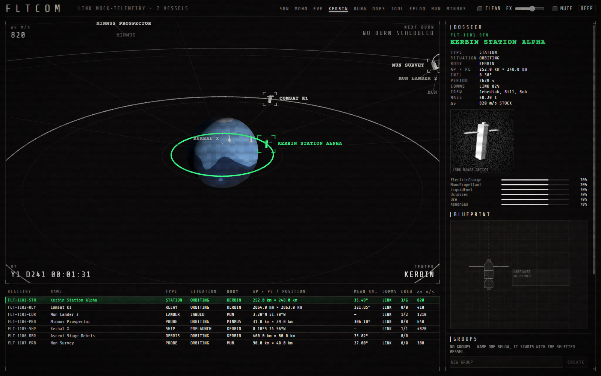
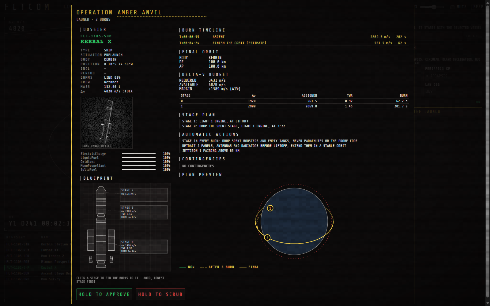
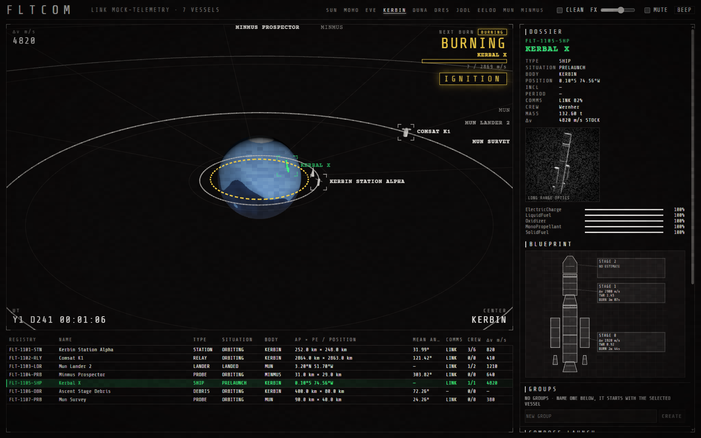
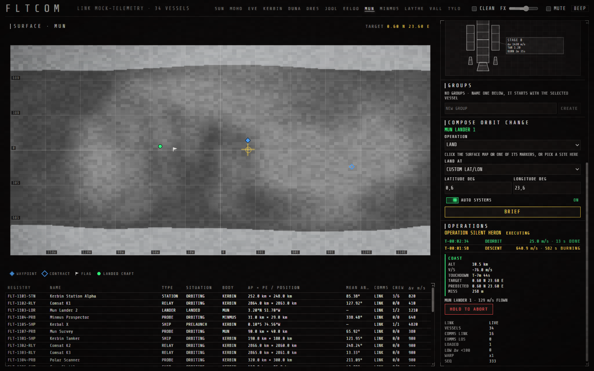
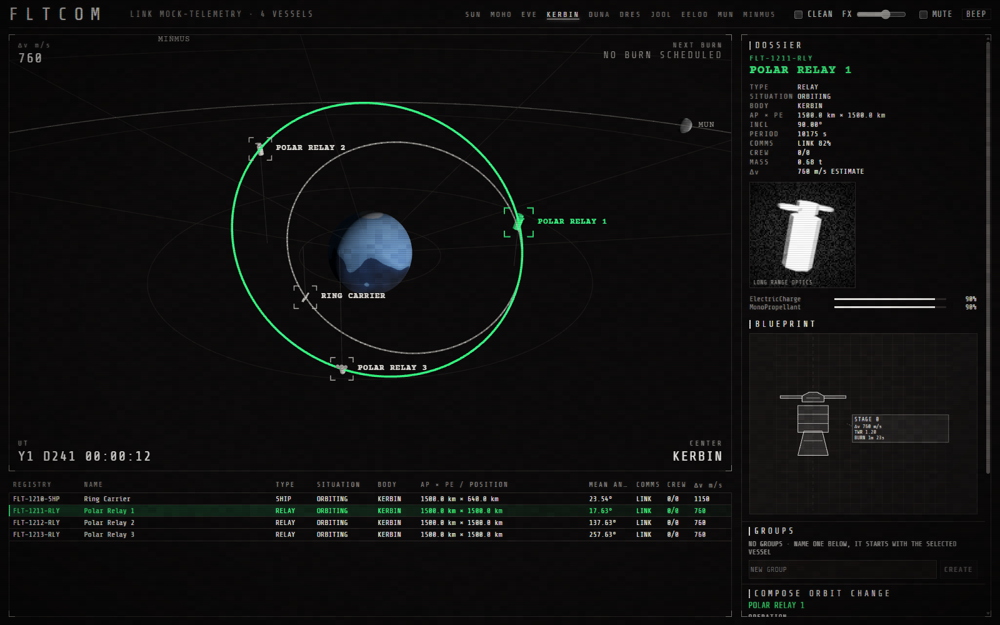
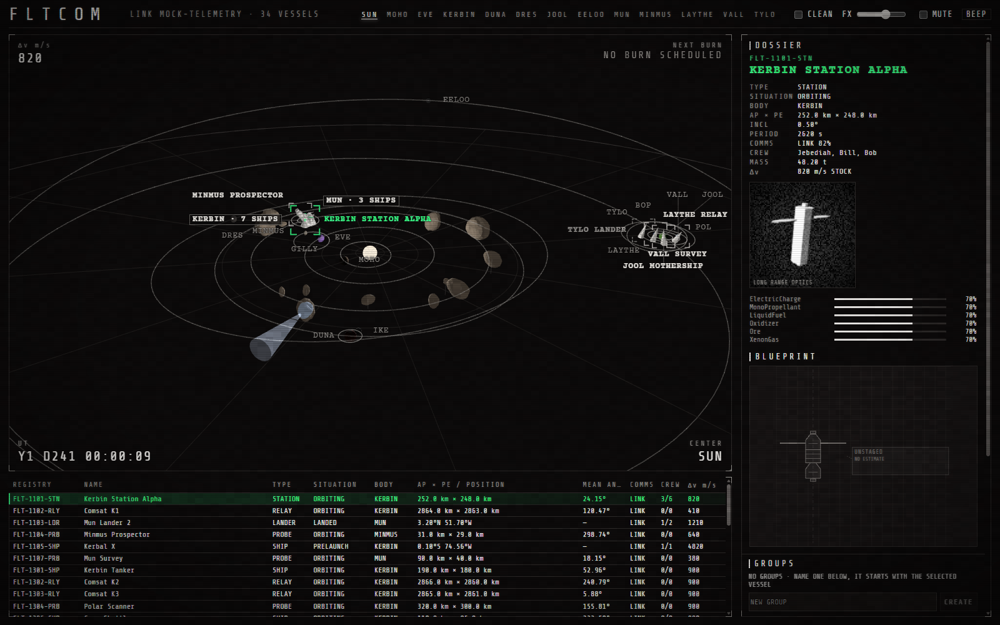

# FLTCOM

FLTCOM is a fleet manager for **Kerbal Space Program 1.12.5**. It tracks every ship in your save on a 3D map in your browser, briefs each operation you compose, and flies the burns once you approve.



*The display with demo telemetry.*

[Project website](site/index.html) · [Releases](../../releases) · [Give feedback](#give-feedback)

## What's new in the preview

The display is completely refreshed, and FLTCOM now flies much more than orbit changes:

- **Launch to orbit** from the launch pad to a target orbit, optionally waiting for a plane.
- **Landings** on the launch pad, the runway, or chosen coordinates, with a live descent readout.
- **Transfers** to a moon or another planet, with a transfer window chart for planets.
- **Rendezvous and docking** with another ship, to a port you choose.
- **Satellite carriers** that release their satellites into an evenly spaced ring, equatorial or tilted, then fly home.
- **Automatic systems** that stage and work landing gear, fairings, solar panels, antennas and radiators during an operation.
- **A 3D map** of the whole Kerbol system.

Orbit changes (circularize, apoapsis, periapsis, inclination, circular orbit at an altitude, standard low orbit) and named groups with background burns are still there.

## Feature tour

**Read the plan before you approve.** Every operation becomes a briefing with a codename, a burn timeline, a delta-v budget per stage, the automatic actions, and a plan preview.



*A launch briefing. Demo telemetry.*

**Watch it fly.** The map follows the burn while the countdown turns into IGNITION and a delta-v bar fills.



*A live launch burn. Demo telemetry.*

**Land where you point.** A descent shows altitude, vertical speed, time to touchdown and the predicted miss, with the landing marker on the surface map.



*A Mun descent. Demo telemetry.*

**Build a constellation in one order.** A carrier releases its satellites one pass apart, and each one circularizes into its slot on the ring.



*A polar ring of three after a carrier deploy. Demo telemetry.*

**Pull back to the system.** Centre the map on the Sun to see every planet, your ships and nearby asteroids, with labels kept apart.



*The system view. Demo telemetry.*

## Install

FLTCOM is not on CKAN yet. Install it by hand:

1. Download the FLTCOM package from [Releases](../../releases), not the source code archive.
2. Close KSP and back up your save.
3. Copy the package's `GameData/FLTCOM` folder into your KSP `GameData` folder. You should end up with `GameData/FLTCOM/FLTCOM.dll`.
4. Start KSP 1.12.5 and load a save.

## Quick start

1. Open **http://127.0.0.1:47800/** on the same computer, or click the FLTCOM toolbar button. The display works well on a second monitor. It is localhost only.
2. Select a ship on the map or in the fleet list. It needs fuel and maneuver-direction SAS; career saves need maneuver planning unlocked.
3. Compose an operation. A ship on the launch pad gets a launch; a ship in orbit gets the full list. Click **BRIEF**.
4. Read the briefing. Clear any red contingency, then hold **APPROVE** (mouse, Enter or Space).
5. Answer the warp prompt when it appears and watch the operation. Hold **SCRUB** to cancel. A held operation offers **RESUME**.

For several ships, create a named group in the **GROUPS** panel and add ships to it. Give the group one order, or spread its ships evenly around one orbit. Ships far from the one you fly burn in the background.

## Give feedback

This preview exists to find out whether the new display works. Tell us what confused you, what felt slow, and how much you like the look:

- [UI feedback](../../issues/new?template=ui-feedback.yml) for anything about the look and feel. One screen per issue is easiest to act on.
- [Bug report](../../issues/new?template=bug-report.yml) for anything that breaks.

Known limits of the preview: constellation rings are equatorial or tilted and only around the body the carrier orbits; background burns only stage; a spent stage stays attached until you press space; the display is localhost only; KSP 1.12.5 only. The [release notes](docs/release/v0.1.0-preview.md) have the details.

## Build from source

Contributors need the .NET 8 SDK, Node.js 22.18 or newer, and KSP 1.12.5. Set `KSP_ROOT` if the game is not in the default installation location, then run:

```powershell
powershell -NoProfile -File tools/build.ps1
```

The package is written to `dist/GameData/FLTCOM/`. See [CI checks](.github/workflows/ci.yml) and [website maintenance](site/UPDATING.md). The public website is plain HTML and CSS and needs no build step.

## License

FLTCOM is free software under the GNU General Public License v3.0 (see `LICENSE`), Copyright (C) 2026 the FLTCOM contributors. This lets FLTCOM reuse code from MechJeb, which is also GPL-3.0; any reused file keeps its original copyright notice. The bundled fonts are licensed under the SIL Open Font License 1.1, and each font folder carries its `OFL.txt`.
